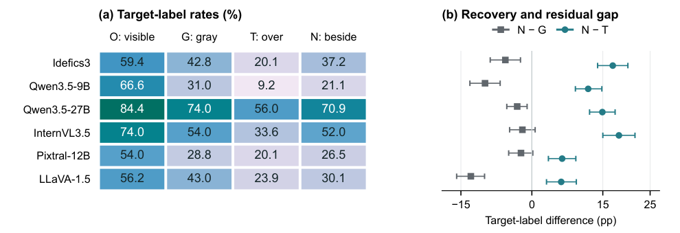
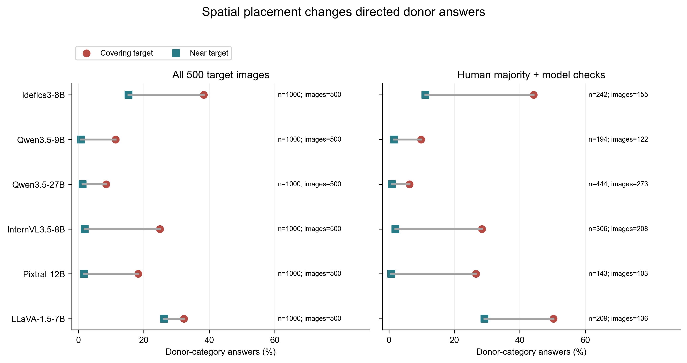

---
language:
- en
task_categories:
- visual-question-answering
size_categories:
- 1K<n<10K
tags:
- benchmark
- occlusion
- visual-grounding
- robustness
pretty_name: OTC-Bench
configs:
- config_name: model_inputs
  data_files:
  - split: test
    path: data/model_inputs.jsonl
---

# OTC-Bench: Overlay–Target Confusion Benchmark

**Version 0.2.0-rc1. Paper-aligned preview; primary inputs and outputs remain frozen.**

[Code and evaluation](https://github.com/Seren666/OTC-Bench) · [Dataset and cached outputs](https://huggingface.co/datasets/MortalSnow/OTC-Bench)

Associated manuscript in preparation: *OTC-Bench: A Paired Spatial-Exchange Benchmark for Occluded Target Recognition*. No paper or DOI is claimed yet.

This diagnostic benchmark asks whether a vision-language model names an artificial object-pattern distractor as a specified original target. A paired exchange moves identical distractor pixels from the target to a nearby non-overlapping slot, while retaining the same visible target pixels. The benchmark reports target-label rates, donor-label rates, UNKNOWN and other operational labels separately; lexical labels are not independent visual accuracy judgments.


## Paper-aligned analysis

The default benchmark CLI preserves the historical release. For current manuscript W/A results, 10,000-draw target-cluster intervals, readability corrections, independent interpretation audit summaries, and the Pixtral budget check, see [paper evidence](paper/README.md).

```bash
python -m pip install -r requirements-paper.txt
python benchmark.py verify
python paper_replay.py --output replayed_paper
```



The four-condition ordering is a point-estimate ordering. All six N−T target intervals exclude zero; N−G excludes zero in four models. Low donor-label prevalence does not establish target recognition. Paper results use signed N−T, whereas preserved historical result files use T−N donor contrasts. These conventions are explicitly versioned, not pooled.

The public update preserves 38,400 primary 32-token answers, adds the frozen A scoring ledger and numerical audit/budget records, and retains the old release. It does not upload individual participant questionnaires, source photographs, or the unpublished manuscript. No new GPU inference is required to replay these records.

## Contents and counts

- 800 distinct COCO val 2014 target images, one annotated target per image.
- 16 shared donor crops from eight categories; two different donor categories per target.
- 1,600 target-donor pairs; **6,400 unique input images**, not 6,400 independent scenes.
- Six cached model runs, 6,400 answers each: **38,400 formal answers**.
- Earlier cohorts: 96 + 204 targets. Later frozen validation: 500 targets. Report them separately before any descriptive 800-target aggregate.
- Stimulus-readability study: 3,900 judgments on 1,300 target-donor pairs. Earlier 300: one donor per target, three readings. Later 500: both donors per target, three readings. Do not claim 4,800 human judgments or full two-donor human coverage on all 800 images.

## Conditions

| Code | What is on the target? | What is near it? | Purpose |
|---|---|---|---|
| O | Original pixels | Gray slot | Baseline; not an unmodified original photograph |
| G | Gray rectangle | Gray slot | Gray-occluded baseline |
| T | Object-pattern donor | Gray slot | Target-overlap condition |
| N-near | Gray rectangle | Identical object-pattern donor | Matched spatial exchange |
| donor-check | Donor at its T size/location | Entire remaining canvas gray | Check donor recognition at rendered size |

The original image is on the left; a gray sidebar and gray sidebar slot remain in every condition. A four-pixel red target-box outline specifies the original target. T/N-near do **not** restore hidden target pixels. Position, visual attention and scene interpretation can all change; the pair is not proof of an internal mechanism.

## Quick start

Clone either repository to obtain the complete portable evaluation package:

```bash
git clone https://github.com/Seren666/OTC-Bench.git
cd OTC-Bench
```

Use Python 3.11 or newer in a fresh environment. On Windows:

```powershell
python -m venv .venv
.venv/Scripts/python -m pip install -r requirements.txt
.venv/Scripts/python benchmark.py verify
.venv/Scripts/python benchmark.py evaluate --predictions predictions/idefics3.jsonl --output my_results.csv
```

On Linux/macOS replace `.venv/Scripts/python` with `.venv/bin/python`. Evaluation itself uses only the Python standard library. This command reproduces cached answers; it does not call a model.

To reconstruct inputs, first review `LICENSE_STATUS.md` and the source-image licenses:

```powershell
.venv/Scripts/python benchmark.py download-sources --sources sources
.venv/Scripts/python benchmark.py render --sources sources --output images
```

Downloading source images is an explicit user action; evaluation never downloads anything. If the COCO host is unavailable, obtain the official COCO val 2014 archive and place the listed original JPEGs in `sources/`. SHA256 checks reject modified files. Rendering requires the libjpeg-turbo Pillow build: a non-turbo JPEG decoder can differ by one intensity value and will correctly fail the frozen RGB-hash check. Do not bypass the check or compare new images with old model answers.

## Evaluate another model

Read **only** `data/model_inputs.jsonl` in the inference adapter; it contains neutral IDs, image paths and the exact prompt. Do not pass category labels, answers, human votes or semantic filenames to the model. Apply that model's native preprocessing/chat template and document its revision, precision, image splitting and deterministic decoding. Never retry a valid but incorrect answer to improve it.

Write one JSON object per line:

```json
{"request_id":"T0001__O","answer":"oven"}
```

Provide exactly all 6,400 IDs, or use `--cohort new_500` with exactly its 4,000 IDs. Blank, missing and duplicate answers fail validation; they are engineering failures, not UNKNOWN. A model's explicit `UNKNOWN` is a valid recorded response.

```powershell
.venv/Scripts/python benchmark.py evaluate --predictions my_model.jsonl --scoring format_tolerant --output my_model_results.csv
.venv/Scripts/python benchmark.py evaluate --predictions my_model.jsonl --scoring frozen --output my_model_frozen.csv
```

The default `format_tolerant` rule is the already-used uniform alias-in-sentence score, not a new judge model. `frozen` preserves the historical short-category scorer. Read `SCORING.md`: neither parser is a complete semantic adjudicator, and donor mentions must not automatically be called strict identity substitutions.

## Files

- `data/targets.jsonl`: source IDs, labels, segmentation, fixed R/P/S rectangles, sizes, cohort and donor assignments.
- `data/donors.jsonl`, `sources.jsonl`: crop recipes, original hashes, COCO/Flickr URLs and recorded licenses.
- `data/requests.jsonl`: full evaluation keys, exact prompts and frozen RGB/PNG hashes.
- `data/model_inputs.jsonl`: label-free model-facing input list.
- `data/human_votes.jsonl`: aggregate frozen vote counts, without names, timestamps, clicks or free-text reasons.
- `predictions/`: cached raw answer strings under neutral request IDs.
- `configs/`: recorded model revisions and runtime parameters; missing historical revision metadata is explicit.
- `results/`: cohort-separated scores, all-pair and conditioned scopes, donor strata, both scoring modes.
- `figures/`: quantitative plots and captions. Photo examples are retained in the owner's internal review bundle pending rights review.

## Use and limitations

This is a stress-test diagnostic for artificial object-pattern occlusion, not a natural-occlusion prevalence estimate. Shared donors limit inference across donor instances; confidence intervals condition on this donor bank. Model-specific reliability filters produce different denominators, so use full common-cohort results for comparisons and conditional rows to diagnose failure, not to claim an adjusted leaderboard.

The new 500 targets were frozen before their outputs were inspected but were drawn from familiar COCO imagery and use the existing donor bank. Do not describe them as universally unseen by models or as an untouched donor holdout. No train/test split for method development is established here. Reserve new independent evaluation if later tuning a repair method.

Human prompts were simplified Chinese rather than literally identical to the model's English prompt. One reader knew the research; repeat exposure to two donor versions may matter. Human votes support a readability analysis, not a definitive human-vs-model ability ranking. See the three microwave-target scorer-coverage exception in `SCORING.md`.

## Citation and release status

The project owner has authorized public distribution at the two repositories above. Cite OTC-Bench by repository URL and the exact commit used until a paper and archival identifier are available. No paper DOI, dataset DOI or final author list has been assigned. Cite COCO as the source dataset as well. Component-specific rights and the current code/metadata licensing status are recorded in `LICENSE_STATUS.md`; public accessibility does not override source-image terms.


## Historical preview display

This plot preserves the 0.1.0-rc1 presentation. Use the paper-aligned four-condition figure above for the current manuscript.



Left: all 1,000 pairs from 500 target images. Right: model-specific conditioned subsets, with different denominators. Donor-answer counts include the existing format-tolerant scoring; strict category answers and descriptions are separated in the released sensitivity table. See [main results](MAIN_RESULTS.md), [scoring](SCORING.md), and [figure captions](figures/CAPTIONS.md).

